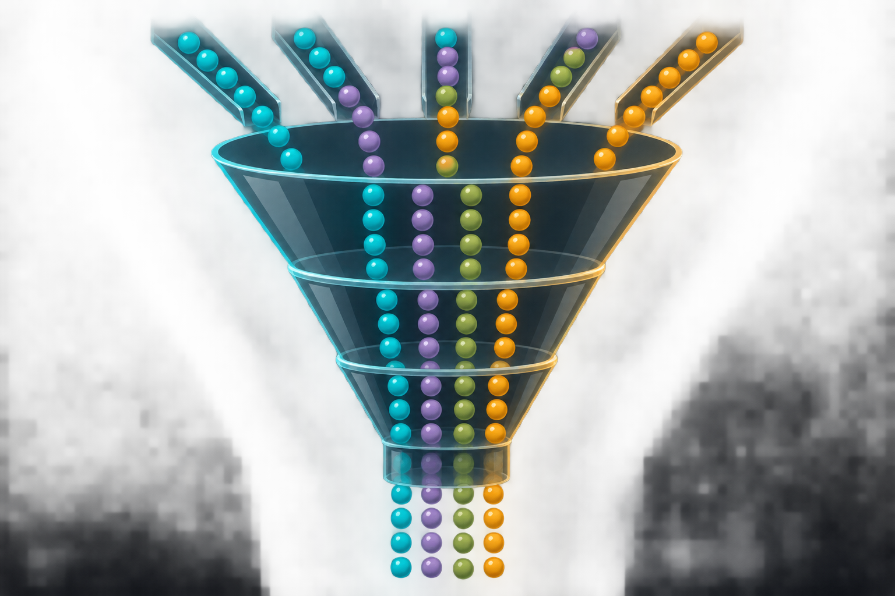
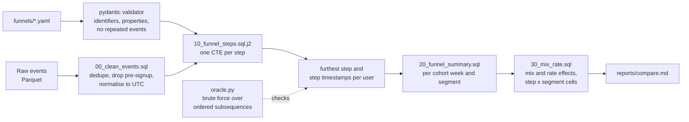

# funnelshift

[](https://github.com/SlateGitOrg/funnelshift/actions/workflows/ci.yml)



funnelshift computes product funnels in DuckDB SQL with the step-order and window rules written down, and explains a change in conversion by splitting it into a mix effect (who signed up) and a rate effect (how each segment converted). Funnels are declared in YAML and validated before any SQL is rendered. The step-matching SQL is tested against a brute-force oracle that tries every ordered subsequence of each user's events, and the decomposition uses midpoint weights so the two effects add up to the observed change exactly. All data is synthetic and generated by a seeded generator in the repo.

## The problem

Product analysts are asked every week why trial-to-paid conversion moved. Ad hoc funnel queries disagree on step order, repeated events, identical timestamps and the conversion window, so the same week gives different numbers in different dashboards. Worse, a drop caused by a change in traffic mix, such as a paid campaign bringing low-intent Android signups, gets reported as a product regression. Engineers then hunt for a bug that does not exist while a real release regression goes unnoticed.

## How it works



Step rules, as implemented in `sql/10_funnel_steps.sql.j2`:

- Step 1 is the user's earliest qualifying step-1 event. It starts the conversion window (14 days by default).
- Step k is the earliest qualifying step-k event with a timestamp at or after step k-1 (ties count as in order) and at most `window_days` after step 1. A subscription exactly 14 days after signup counts; one second later does not.
- The cohort is the ISO week (Monday start, UTC) of the user's first signup, and the segment comes from that signup. A second signup does not restart the clock.
- Cohort weeks are reported only once their last possible signup plus the window is not after the latest event in the data. The generated data stops 21 days after the last signup, so a `window_days: 21` run drops the final cohort week (2025-W42) and says so.

The decomposition in `sql/30_mix_rate.sql`, for segment cells with entry weights `w` and conversion `c` in a base period 0 and a test period 1:

```
mix  = sum((w1 - w0) * (c0 + c1) / 2)
rate = sum((c1 - c0) * (w0 + w1) / 2)
mix + rate = sum(w1*c1) - sum(w0*c0)      (an identity, no residual)
```

The raw per-cell mix term is not centred: a cell that gains weight shows a positive term whatever its conversion. The report therefore prints each cell's mix as `(w1 - w0) * ((c0 + c1) / 2 - C)`, with `C` the overall midpoint conversion. It sums to the same total because the weight changes sum to zero, and its sign says whether the cell pulled the average up or down.

The same split is applied to each step's conditional rate (users at step k / users at step k-1), weighted by each cell's share of the users at step k-1, so a rate effect can be pinned to a step x segment cell.

## Quick start

```bash
python -m venv .venv
source .venv/bin/activate
pip install -e ".[dev]"

funnelshift generate                      # data/events.parquet, truth.parquet, meta.json
funnelshift funnel --def funnels/trial.yaml --weeks 2025-W31..2025-W34
funnelshift compare --def funnels/trial.yaml \
    --base 2025-W31..2025-W34 --test 2025-W35..2025-W38 --by platform,source
funnelshift explain --def funnels/trial.yaml          # the rendered step SQL
funnelshift explain --def funnels/trial.yaml --all    # every SQL stage
pytest -q
```

`compare` prints the report and writes it to `reports/compare.md`. `--by` takes any of the segment columns `platform` and `source`.

## Example output

The data is synthetic: 60,000 signups over 20 weeks (2025-W23 to 2025-W42), 361,574 events. `funnelshift generate` reports what it planted:

```
wrote data/events.parquet (361,574 events, 60,000 users)
wrote data/truth.parquet and data/meta.json
  planted duplicate_events: 5,343
  planted pre_signup_events: 1,178
  planted tie_users: 1,200
  planted late_converters: 2,400
  planted double_signups: 300
```

Funnel for four cohort weeks (`funnelshift funnel --def funnels/trial.yaml --weeks 2025-W31..2025-W34`), users reaching each step and conversion from step 1, by platform:

```
trial_to_paid: cohort weeks 2025-W31..2025-W34, 14-day window; conv = cumulative from step 1

  step                   android users      conv   ios users      conv   web users      conv   all users      conv
 ──────────────────────────────────────────────────────────────────────────────────────────────────────────────────
  1. signup                      3,795   100.00%       3,141   100.00%       3,628   100.00%      10,564   100.00%
  2. workspace_created           2,807    73.97%       2,673    85.10%       3,090    85.17%       8,570    81.12%
  3. teammate_invited            1,278    33.68%       1,441    45.88%       1,812    49.94%       4,531    42.89%
  4. project_created               772    20.34%         901    28.69%       1,166    32.14%       2,839    26.87%
  5. subscribed                    439    11.57%         558    17.77%         713    19.65%       1,710    16.19%
```

Weeks 2025-W31..W34 against 2025-W35..W38. From 2025-W35 a paid_social campaign triples android signups from that source, and nothing about the product changes (`funnelshift compare --def funnels/trial.yaml --base 2025-W31..2025-W34 --test 2025-W35..2025-W38`):

```
| Effect | Percentage points |
|---|---|
| Total change | -2.63 |
| Mix (who signs up) | -2.85 |
| Rate (how each cell converts) | +0.21 |

Mix + rate - total = 8.2e-18 (midpoint weights leave no residual).

Verdict: **mix_driven** (`mix_driven` when |mix| >= 2 x |rate|, `rate_driven` when |rate| >= 2 x |mix|, otherwise `mixed`).
```

Per cell, mix is centred on the overall midpoint conversion C, as (w1 - w0) x ((c0 + c1) / 2 - C), so a cell that gains weight at below-average conversion is negative and the column still sums to the total mix effect. The campaign cell carries most of it:

```
| Cell | Weight base > test | Conversion base > test | Mix (pp) | Rate (pp) |
|---|---|---|---|---|
| android / paid_social | 16.80% > 38.47% | 5.41% > 5.16% | -2.08 | -0.07 |
| web / organic | 16.29% > 11.61% | 21.50% > 19.04% | -0.25 | -0.34 |
| web / referral | 6.90% > 5.31% | 27.02% > 29.39% | -0.21 | +0.14 |
| ios / referral | 5.52% > 4.14% | 26.42% > 24.74% | -0.15 | -0.08 |
| ios / organic | 13.81% > 10.31% | 17.27% > 17.68% | -0.09 | +0.05 |
| android / referral | 5.24% > 3.86% | 18.59% > 23.81% | -0.09 | +0.24 |
| android / organic | 8.79% > 6.92% | 19.27% > 18.67% | -0.08 | -0.05 |
| web / paid_social | 6.06% > 4.12% | 10.47% > 13.21% | +0.06 | +0.14 |
| ios / paid_social | 6.21% > 4.73% | 12.65% > 11.36% | +0.04 | -0.07 |
| android / partner | 5.08% > 3.96% | 11.36% > 14.11% | +0.02 | +0.12 |
| ios / partner | 4.19% > 3.13% | 15.58% > 17.61% | -0.02 | +0.07 |
| web / partner | 5.09% > 3.45% | 14.68% > 15.98% | -0.01 | +0.06 |
```

The generator's analytic expectation for the mix effect between these periods is -2.86 points. The largest rate contributions are small and scattered across steps; they are sampling noise, not a signal:

```
| Step | Cell | Conditional rate base > test | Rate contribution (pp) |
|---|---|---|---|
| project_created > subscribed | web / organic | 63.90% > 59.51% | -0.80 |
| project_created > subscribed | web / referral | 64.59% > 71.06% | +0.66 |
| project_created > subscribed | ios / referral | 71.96% > 64.44% | -0.54 |
| teammate_invited > project_created | android / referral | 56.27% > 63.88% | +0.47 |
| teammate_invited > project_created | web / partner | 57.32% > 66.83% | +0.44 |
```

Weeks 2025-W35..W38 against 2025-W39..W42. From 2025-W39 (app release 5.2) android's `teammate_invited > project_created` rate drops from 0.62 to 0.45 in every android cell:

```
| Effect | Percentage points |
|---|---|
| Total change | -1.45 |
| Mix (who signs up) | +0.04 |
| Rate (how each cell converts) | -1.49 |

Mix + rate - total = 3.5e-18 (midpoint weights leave no residual).

Verdict: **rate_driven** (`mix_driven` when |mix| >= 2 x |rate|, `rate_driven` when |rate| >= 2 x |mix|, otherwise `mixed`).
```

```
| Step | Cell | Conditional rate base > test | Rate contribution (pp) |
|---|---|---|---|
| teammate_invited > project_created | android / paid_social | 62.45% > 45.94% | -3.08 |
| teammate_invited > project_created | android / organic | 65.00% > 44.33% | -1.71 |
| teammate_invited > project_created | android / referral | 63.88% > 44.84% | -1.08 |
| project_created > subscribed | web / organic | 59.51% > 63.22% | +0.66 |
| teammate_invited > project_created | android / partner | 63.93% > 48.58% | -0.65 |
```

## Design decisions

- **The window is anchored on the earliest step-1 event.** A user who signs up twice could otherwise restart the clock and turn a day-20 subscription into a conversion. The cost is that a genuine returning user is judged from their first visit; the cohort week and segment follow the same first signup, so the three definitions agree.
- **Earliest match at every step, with `>=` between steps.** Taking the earliest qualifying event at each step leaves the most room for later steps, so it finds the deepest valid path; allowing equal timestamps means two events logged in the same instant do not block each other. Funnel definitions may not repeat an event name, which keeps "which occurrence belongs to which step" unambiguous. The oracle exists to check exactly this claim.
- **Midpoint (symmetric) shift-share.** Using the average of the two periods' weights and rates puts the interaction term into mix and rate in equal parts, so the two effects add up to the observed change with nothing left over. The trade-off is that the split of a cell that changes both weight and rate depends on the midpoint convention. A cell absent from one period borrows the other period's rate, so its whole effect is mix.
- **Validation before rendering, and a small SQL surface.** Event names, property names and segment columns must match `[a-z_][a-z0-9_]*`, properties must be known event columns, and property values are limited to a safe character set and quoted. The template only ever sees a validated `Funnel`. The cost is that new properties or segment columns need a code change in `definitions.py`.
- **Periods are exact week lists.** `compare` joins on the listed weeks, so a list with a gap keeps the gap instead of filling in the range between its ends.
- **Incomplete cohorts are left out, not shown.** A cohort younger than its window would count late converters as non-converters, which looks like a regression. `funnel` and `compare` list the weeks they skipped. The cutoff is the latest event time in the data, so a feed that stops early shortens the reported range.
- **Static SQL stages around one rendered stage.** Only step matching depends on the funnel's length, so only it is a template. Later stages read a long `funnel_reach` table and a `segment` key built from the chosen columns, which lets `compare --by` re-split without touching the SQL files.

## Testing

```bash
pytest -q            # 89 tests, offline
```

- `tests/test_differential.py`: 300 Hypothesis-generated logs (at most 25 users and 12 planted or random events per user, with ties on a half-day grid, repeats, re-signups, duplicates, events before signup, out-of-window events and mixed UTC offsets); the SQL furthest step per user must equal the brute-force oracle. Mutating the SQL (`>=` to `>`, `<=` to `<`) makes it fail.
- `tests/test_fixture.py`: an 8-user fixture whose furthest steps are written by hand, plus window-boundary, UTC, filter and clean-step accounting tests.
- `tests/test_mix_rate.py`: the toy decomposition (0.60/0.25/0.15 to 0.45/0.25/0.30 at constant rates gives -1.50 / -1.50 / 0.00 points), a comparison with an independent Python implementation on random counts, mix + rate = total to 1e-12 on the seeded data, non-contiguous week lists, and the two injected effects: the campaign weeks are `mix_driven`, match the generator's expectation and give the campaign cell the largest negative centred mix contribution, the release weeks put the most negative rate contribution on an android cell at `teammate_invited > project_created`.
- `tests/test_pipeline_on_synthetic_data.py`: the SQL equals the generator's per-user ground truth for 60,000 users at 14 and 21 days; planted duplicates, pre-signup events, identical timestamps and late converters are recovered exactly.
- `tests/test_cli.py` and `tests/test_definitions.py`: a funnel with event name `x'); DROP TABLE events; --` is rejected and no SQL is rendered.

## Project layout

```
funnels/                  trial.yaml, trial_team_plan.yaml
sql/
  00_clean_events.sql     dedupe, drop pre-signup events, UTC, users table, row accounting
  10_funnel_steps.sql.j2  one CTE per step, furthest step per user
  20_funnel_summary.sql   per cohort week and segment: users, conversion, median and p90 gaps
  30_mix_rate.sql         mix and rate effects, end to end and per step
src/funnelshift/
  definitions.py          YAML funnel models and validation
  render.py               Jinja rendering of the step SQL
  run.py                  DuckDB execution over Parquet
  oracle.py               brute-force reference
  synth.py                seeded generator with planted effects and ground truth
  report.py               tables, verdict, compare.md
  weeks.py                ISO week labels and ranges
  cli.py                  generate, funnel, compare, explain
tests/
```

## License

MIT
